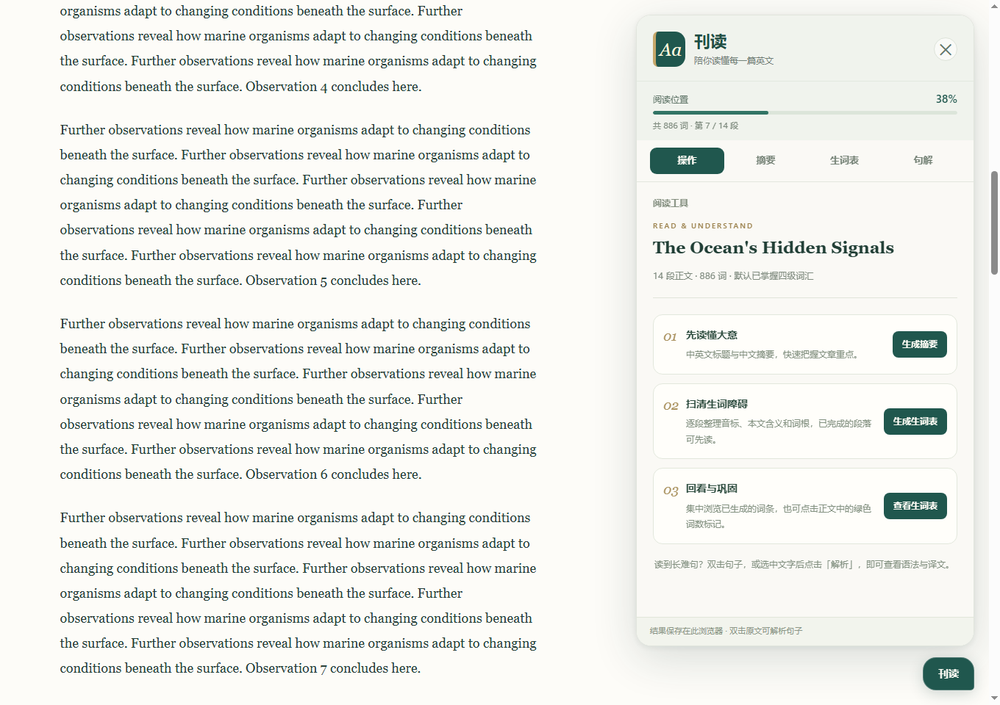
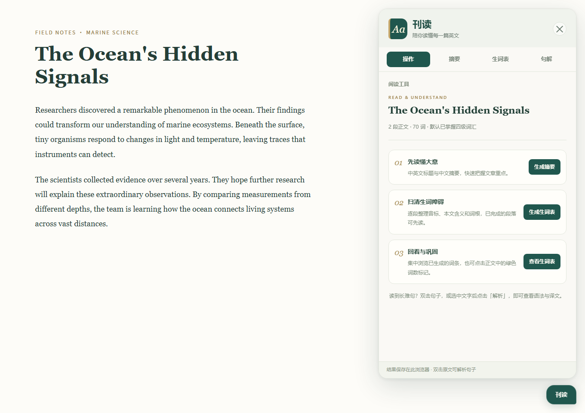
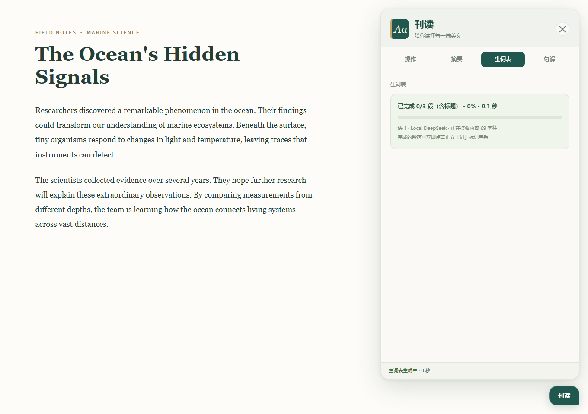
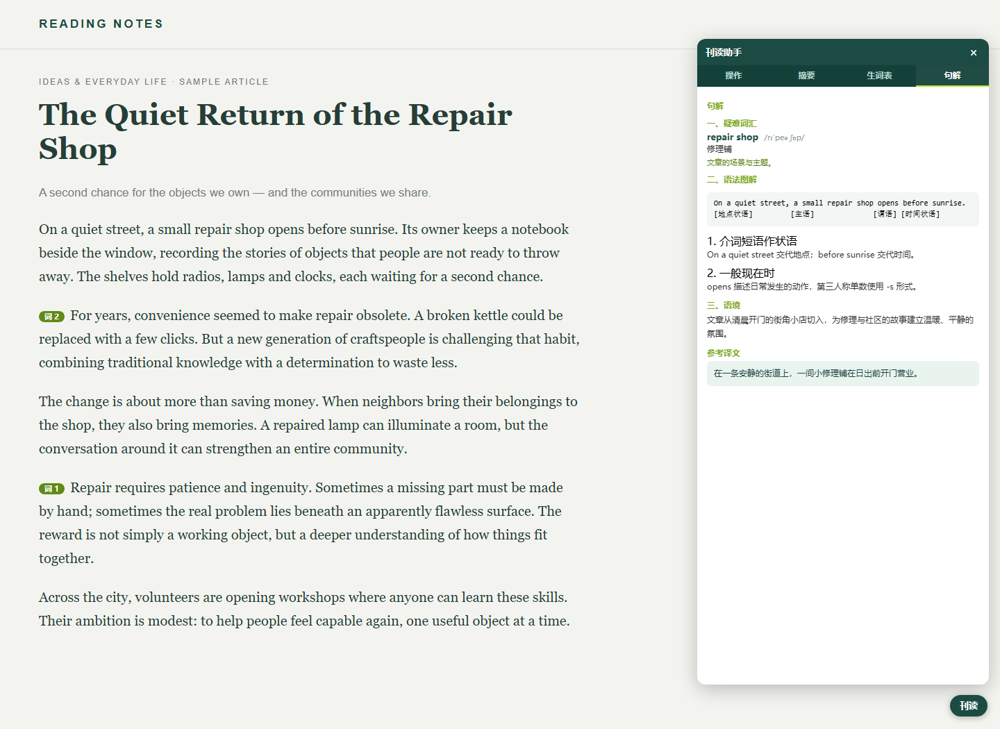

# 刊读助手 · Chrome 扩展（v1.3.2）

英文网页文章阅读辅助：**LLM 摘要 / 逐段生词表 / 双击与选中句解 / 本地 CET-4 粗筛**。
与刊读桌面版（magread-desktop）同源的提示词、多 LLM 轮换与容错逻辑。

v1.3.2 在侧栏顶部增加阅读位置进度条、百分比、文章总词数和当前段落，切换摘要、生词表、句解标签时持续显示。
按正文段落的滚动位置估算，文末完整可见时显示 100%，不把页脚、评论区算入进度；支持正文独立滚动容器。
侧栏滚动不改变阅读位置；关闭后重开按当前正文位置恢复，无需调用 LLM。仅能从结构化数据取得正文、无法匹配网页段落时，显示词数并提示无法定位，不显示虚假的百分比。
同时识别刊读 Web 阅读页，避免重复响应双击、选词；网页弹窗改变文字位置时，校验光标仍在原段落内，避免误解析段落末尾的句子。
更新后在扩展管理页重新加载，并刷新文章页生效。

v1.3.1 补齐 DeepSeek **Anthropic 兼容接口**的关闭思考参数，修复 v1.3.0 只处理 OpenAI 兼容接口的遗漏。
补齐 fell/fallen、shrank/shrunk/shrunken 等不规则词形；某段校验失败时保存其他正常段落，后续只补失败段落。
修正音标输出提示的歧义，避免返回空音标导致反复生成；相同接口、模型和密钥的配置不会因名称不同而重复轮换。

v1.3.0 重新设计暖白、墨绿配色的阅读侧栏与设置页。
摘要、句解显示生成阶段、已接收字符、重试次数和耗时；生词表按实际保存成功的段落显示百分比，
失败块单独提示，完成部分可先读。切换标签或关闭重开侧栏会保留任务进度，避免重复请求。

## 界面预览

在英文网页旁展开刊读侧栏，先看摘要，再查看生词或解析句子，保持原文阅读的连贯性。

每张截图单独展示，点击图片可查看原图。

**阅读进度：正文位置百分比、文章总词数和所在段落，始终显示在侧栏顶部。**

**阅读工具：文章信息、摘要、生词生成与回看入口集中排列。**

**生成进度：已保存段落的真实百分比、当前处理块、模型与接收字符，底部持续显示耗时。**

**逐段生词：原文保留在左侧，音标、本文含义与词根词源集中显示在右侧。**

**文章摘要：中英文标题与中文摘要。**

**句子解析：疑难词汇、语法图解、语境与参考译文。**

截图来自实际运行的扩展，使用原创示例网页及本地模拟接口返回的摘要、释义和句解演示数据；实际生成结果随所选模型而异。

### 其他版本

三个版本分别维护，按阅读场景选择；目前不提供跨端自动同步。

**[Windows 桌面版](https://github.com/haithink/magread-desktop)**：导入 EPUB / PDF，浏览摘要、标记文章、自动续读。

**[Android 手机版](https://github.com/haithink/magread)**：手机上阅读 EPUB / PDF，随时查看生词与句解。

## 下载

**[下载刊读助手 v1.3.2（zip）](https://github.com/haithink/magread-chrome/raw/refs/heads/main/downloads/kandu-helper-chrome-v1.3.2.zip)**

解压到长期保留的文件夹（如 `D:\KanduHelper\`），按下方步骤以开发者模式加载。
注意：解压出的目录就是扩展本体，加载后不可删除。

## 安装（开发者模式加载）

1. 打开 Chrome → 地址栏输入 `chrome://extensions`
2. 右上角打开「开发者模式」
3. 点「加载已解压的扩展程序」→ 选择本文件夹（magread-chrome）
4. 工具栏出现「刊读助手」图标即安装成功

已有安装更新代码后，先在 `chrome://extensions` 点击「刊读助手」的重新加载按钮，
再刷新已打开的文章网页，让新版本的内容脚本生效。

## 使用

1. 打开任意英文文章网页 → 右下角出现「刊读」悬浮球 → 点击打开侧栏
   侧栏顶部显示当前阅读位置、正文总词数和所在段落；百分比随正文滚动，可前进也可回退，不代表已经掌握的词汇比例。
2. 侧栏「操作」区：**生成摘要** / **生成生词表** / 查看生词表
3. 文章每个段落前出现绿色「词 N」徽标，点击展开该段生词（再点收起）
4. **双击句子**或**选中文字 → 悬浮「解析」按钮** → 侧栏显示五段式句解
   （疑难词汇 → 语法对齐图解 → 语法点 → 语境 → 参考译文）
5. 首次使用先点工具栏图标进行 **LLM 设置**（可粘 cc-switch JSON 自动识别、
   多配置管理、★ 默认、失败轮换、获取可用模型）

## 说明

- 摘要/生词按网页 URL 缓存，新缓存带正文哈希校验；同一 URL 的文章更新后重新生成。
  旧版缓存继续兼容。句解按 URL 和所选句子缓存。
- 生词表默认已掌握四级词汇，本地先筛候选词，LLM 结合正文给出本文含义、音标、词根词源，
  并补充熟词僻义和词组。要求所有返回词条给出音标，四级词表中已有的音标优先本地回填；未内置完整 ECDICT。
- 标题合并到首块，正文约 4500 字符分块（单个长段落保留全文），最多两块同时请求。
  模型输出紧凑词条，段首和原文短语由本地提取，减少重复输出。
- 每块返回后立即保存校验通过的段落并显示正文徽标；未完成的段落自动轮换其他已配置模型，
  再点「继续生成生词表」只重试未完成段落。缺段、截断、无释义或无音标的结果不标记完成。
- 同一文章同时触发生成会合并任务，避免重复请求；支持流式响应及直接返回 JSON 的兼容网关，
  每次请求超时 120 秒。生成结果显示耗时，后台缓存记录逻辑调用次数和输入/输出字符数（非实际 token）。
- DeepSeek 的 OpenAI 和 Anthropic 兼容请求默认附带 `thinking: {type: "disabled"}`，覆盖摘要、生词表和句解；
  其他模型保持接口默认行为。已有配置和缓存可继续使用。
- 摘要和句解使用不定进度条，显示实际阶段、经过秒数与正文接收字符数，不估计完成百分比。
  生词表百分比按已成功保存的段落（包含标题）计算，显示并行块、模型、接收状态及失败待补数量。
- 任务状态与面板 DOM 分开保存，关闭侧栏后继续生成并保存结果，完成时不会重新弹出侧栏；
  切换标签时也不会被完成回调切回结果页。刷新网页后可再次点击生成以加入后台同文任务；
  浏览器退出或扩展重载会中断在途请求，生词表下次只补已保存结果之外的段落。

## 文件

- `manifest.json` MV3 清单
- `background.js` service worker：LLM 调用、提示词、缓存、编排
- `content.js` / `content.css` 正文抽取与界面注入
- `popup.html` / `popup.js` 设置弹窗
- `assets/cet4_words.txt` CET-4 词表（本地粗筛用）

## 开发验证

使用 Node.js 22 或更新版本运行 `node --test tests/*.test.cjs`。
测试默认使用同级 `../chrome-win64/chrome.exe`，也可用环境变量 `CHROME_PATH` 指定
Chrome / Chrome for Testing 的可执行文件；找不到浏览器时会跳过测试。
测试使用临时浏览器配置和本地模拟 LLM，无需 API Key，不使用现有浏览器配置。
如需保存测试截图，`KANDU_SCREENSHOT_DIR` 必须设为本扩展目录之外的位置（例如系统临时目录）；
测试会拒绝将截图写到扩展内部，避免 `_dbg` 等保留名称导致 Chrome 无法加载扩展。
覆盖操作按钮、标签切换、未配置 LLM 提示、摘要/生词表生成、缓存恢复、关闭重开和句解显示，
以及紧凑词条、候选词、两路并发、逐块保存、任务去重、失败续传、内容更新、存储异常、
OpenAI 兼容与 Anthropic 流式响应、截断及额度重试、DeepSeek 非思考请求、进度与请求身份、
生成中关闭重开、关闭后完成不重新弹窗、窄屏滚动、模型配置重命名、DeepSeek Anthropic 完整调用链、
WIRED 词形匹配和段落级保存，共 38 项通过。自动测试只调用本地模拟接口。

2026-11-12 另用用户配置的 DeepSeek Anthropic 接口实测指定的 WIRED 文章：
同一句解不传思考设置为 26.9 秒，传 `disabled` 为 5.2 秒，思考字符从 11,164 降至 0；
修正后的后台从空缓存处理标题及 20 段正文，用时 12.8 秒，21/21 段保存成功、失败块 0、思考字符 0。
这些是单次实测数据，时间会随接口负载、文章长度与模型输出变化；实测不修改用户配置或文章缓存。

## 许可证

本项目原创代码采用 [MIT License](LICENSE)，版权归 haithink 及贡献者所有。
第三方词表资源的许可范围见 [第三方资源说明](THIRD_PARTY_NOTICES.md)。
