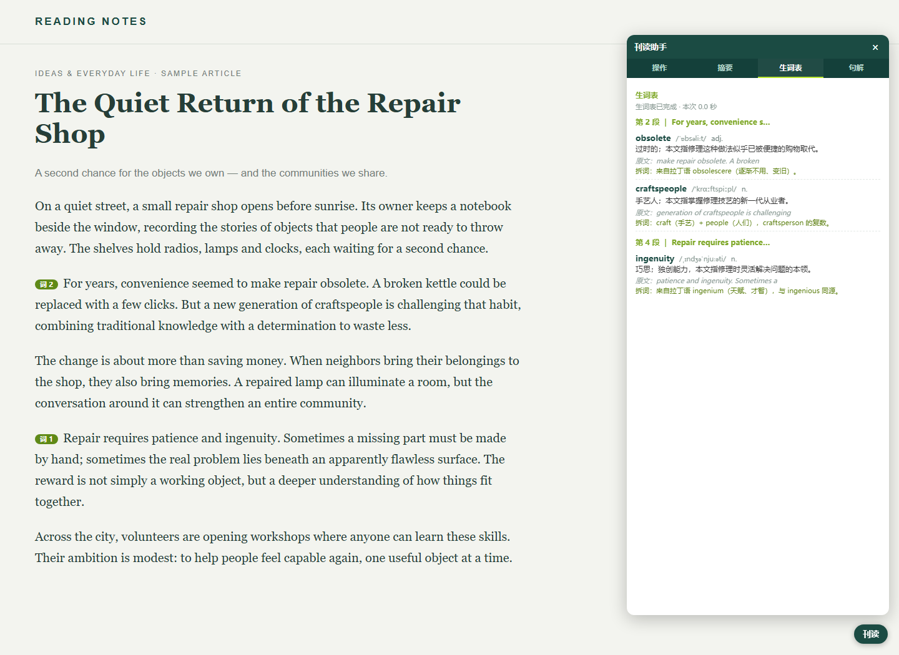
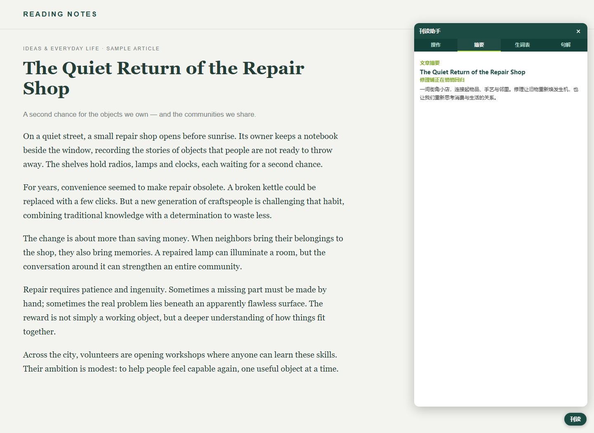

# 刊读助手 · Chrome 扩展（v1.2.0）

英文网页文章阅读辅助：**LLM 摘要 / 逐段生词表 / 双击与选中句解 / 本地 CET-4 粗筛**。
与刊读桌面版（magread-desktop）同源的提示词、多 LLM 轮换与容错逻辑。

## 界面预览

在英文网页旁展开刊读侧栏，先看摘要，再查看生词或解析句子，保持原文阅读的连贯性。

**逐段生词：原文保留在左侧，音标、本文含义与词根词源集中显示在右侧。**

<table>
  <tr>
    <th>中英文标题与中文摘要</th>
    <th>句子解析与参考译文</th>
  </tr>
  <tr>
    <td></td>
    <td></td>
  </tr>
</table>

截图来自实际运行的扩展，使用原创示例网页及本地模拟接口返回的摘要、释义和句解演示数据；实际生成结果随所选模型而异。

### 其他版本

三个版本分别维护，按阅读场景选择；目前不提供跨端自动同步。

| [Windows 桌面版](https://github.com/haithink/magread-desktop) | [Android 手机版](https://github.com/haithink/magread) |
| --- | --- |
|  |  |
| 导入 EPUB / PDF，浏览摘要、标记文章、自动续读。 | 手机上阅读 EPUB / PDF，随时查看生词与句解。 |

## 下载

**[下载刊读助手 v1.2.0（zip）](https://github.com/haithink/magread-chrome/raw/refs/heads/main/downloads/kandu-helper-chrome-v1.2.0.zip)**

解压到长期保留的文件夹（如 `D:\KanduHelper\`），按下方步骤以开发者模式加载。
注意：解压出的目录就是扩展本体，加载后不可删除。

## 安装（开发者模式加载）

1. 打开 Chrome → 地址栏输入 `chrome://extensions`
2. 右上角打开「开发者模式」
3. 点「加载已解压的扩展程序」→ 选择本文件夹（magread-chrome）
4. 工具栏出现「刊读助手」图标即安装成功

已有安装更新代码后，先在 `chrome://extensions` 点击「刊读助手」的重新加载按钮，
再刷新已打开的文章网页，让新版本的内容脚本生效。

## 使用

1. 打开任意英文文章网页 → 右下角出现「刊读」悬浮球 → 点击打开侧栏
2. 侧栏「操作」区：**生成摘要** / **生成生词表** / 查看生词表
3. 文章每个段落前出现绿色「词 N」徽标，点击展开该段生词（再点收起）
4. **双击句子**或**选中文字 → 悬浮「解析」按钮** → 侧栏显示五段式句解
   （疑难词汇 → 语法对齐图解 → 语法点 → 语境 → 参考译文）
5. 首次使用先点工具栏图标进行 **LLM 设置**（可粘 cc-switch JSON 自动识别、
   多配置管理、★ 默认、失败轮换、获取可用模型）

## 说明

- 摘要/生词按网页 URL 缓存，新缓存带正文哈希校验；同一 URL 的文章更新后重新生成。
  旧版缓存继续兼容。句解按 URL 和所选句子缓存。
- 生词表默认已掌握四级词汇，本地先筛候选词，LLM 结合正文给出本文含义、音标、词根词源，
  并补充熟词僻义和词组。四级词表中已有的音标直接本地回填；未内置完整 ECDICT。
- 标题合并到首块，正文约 4500 字符分块（单个长段落保留全文），最多两块同时请求。
  模型输出紧凑词条，段首和原文短语由本地提取，减少重复输出。
- 每块完成立即保存并显示正文徽标；未完成的块自动轮换其他已配置模型，
  再点「继续生成生词表」只重试未完成段落。缺段、截断、无释义或无音标的结果不标记完成。
- 同一文章同时触发生成会合并任务，避免重复请求；支持流式响应及直接返回 JSON 的兼容网关，
  每次请求超时 120 秒。生成结果显示耗时，后台缓存记录逻辑调用次数和输入/输出字符数（非实际 token）。

## 文件

- `manifest.json` MV3 清单
- `background.js` service worker：LLM 调用、提示词、缓存、编排
- `content.js` / `content.css` 正文抽取与界面注入
- `popup.html` / `popup.js` 设置弹窗
- `assets/cet4_words.txt` CET-4 词表（本地粗筛用）

## 开发验证

使用 Node.js 22 或更新版本运行 `node --test tests/*.test.cjs`。
测试默认使用同级 `../chrome-win64/chrome.exe`，也可用环境变量 `CHROME_PATH` 指定
Chrome / Chrome for Testing 的可执行文件；找不到浏览器时会跳过测试。
测试使用临时浏览器配置和本地模拟 LLM，无需 API Key，不使用现有浏览器配置。
覆盖操作按钮、标签切换、未配置 LLM 提示、摘要/生词表生成、缓存恢复、关闭重开和句解显示，
以及紧凑词条、候选词、两路并发、逐块保存、任务去重、失败续传、内容更新、存储异常、
OpenAI 兼容与 Anthropic 流式响应、截断及额度重试。测试只调用本地模拟接口。

## 许可证

本项目原创代码采用 [MIT License](LICENSE)，版权归 haithink 及贡献者所有。
第三方词表资源的许可范围见 [第三方资源说明](THIRD_PARTY_NOTICES.md)。
